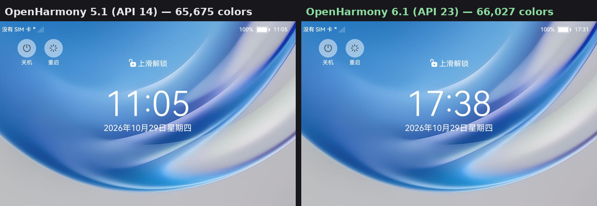
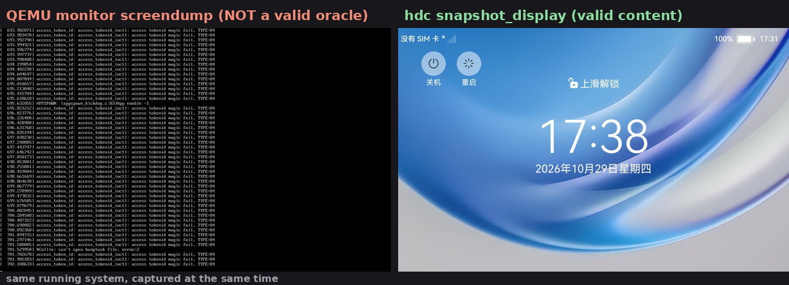

# 从源码到 QEMU：构建能真正"看见"的 OpenHarmony x86_64 镜像（5.1 与 6.1 / API 23 双版本实战）

> 本文记录把 OpenHarmony 5.1（API 14）与 6.1（API 23）的 x86_general 产品移植到
> QEMU 虚拟机的完整过程：从 500 多个仓库的源码同步、内核与图形栈修补，到磁盘组装、
> 启动验证，以及中间踩过的每一个有代表性的坑。全部补丁、脚本与文档已开源：
> **[guoqiangqi/OpenHarmony-x86-Port](https://github.com/guoqiangqi/OpenHarmony-x86-Port)**。

## 1. 先看结果

两个版本都可以在一台普通的 x86 服务器上完成构建，并在 QEMU 里启动到锁屏界面，
通过 hdc 抓取到内容完整的截图：



| 版本 | API | 截图全像素颜色数 | mean RGB | 验证口径 |
|------|-----|----------------|----------|----------|
| OpenHarmony 5.1.0 Release | 14 | 65,675 | [120.3, 158.9, 202.6] | `hdc snapshot_display` |
| OpenHarmony 6.1 Release | 23 | 66,027 | [120.3, 158.9, 202.6] | 同上（阈值 ≥ 60,000 色） |

两个数字几乎一致并不是巧合：它们是同一个锁屏 UI。对这类移植工作来说，
"系统能启动"只是及格线，**截图里有真实 UI 内容**才证明内核、HDI、图形栈、
窗口系统、ArkUI 全链路都活着。

## 2. 这件事难在哪

OpenHarmony 官方发布以 ARM 平台为主，x86_64 没有官方 QEMU 镜像。社区里
diemit 维护的 opc 三仓（vendor_opc / device_board_opc / device_soc_opc）是
目前最完整的 x86 硬件适配层，但它的版本只跟到 **6.0-Beta1**——想在 6.1 上跑，
就得自己移植。

难点集中在三处：

1. **版本断层**。6.1 相对 5.1/6.0 的变化远不止"换个 tag"：内核源码布局变动、
   hdf_devhost 从 hdf_core 拆分到新组件、vendor 内容从 system 镜像拆到独立分区、
   data 分区默认文件系统从 ext4 换成 f2fs、RenderService 的渲染架构重构。
   每一项单看都不大，叠在一起就是"镜像能编出来但起不来"。
2. **图形栈是黑盒重灾区**。virtio-gpu 没有硬件 vblank、OHOS 的 clang/musl
   组合触发 mesa 的 emulated-TLS 缺陷、EGL wrapper 对 display 的单例约束，
   这些问题互相纠缠，表现都是同一句话："截图是黑的"。
3. **验证口径本身是个坑**（第 7 节展开）：QEMU 的 screendump 对这套系统
   根本不反映真实显示内容，拿它当判据会把排查带进死胡同。

## 3. 移植结构：三层

```
┌──────────────────────────────────────────────┐
│ OpenHarmony 本体（repo manifest 按 tag 同步）  │  500+ 仓，不含 x86 产品
├──────────────────────────────────────────────┤
│ opc 三仓（gitee.com/diemit，x86 硬件层）      │  vendor_opc / device_board_opc / device_soc_opc
│                                              │  社区最高 6.0-Beta1，6.1 需自行续命
├──────────────────────────────────────────────┤
│ 本仓库：纯增量（补丁 / 脚本 / 文档 / 探针）    │  github.com/guoqiangqi/OpenHarmony-x86-Port
└──────────────────────────────────────────────┘
```

OpenHarmony 本体不适合用 submodule 管理，按社区惯例用 repo 工具同步；opc 三仓
很小，直接 clone 后 checkout 到固定 commit（两版的基线 commit 都写在仓库 README
里，已与实际源码树逐一核对）。本仓库只保存增量，便于跟随上游演进 rebase。

## 4. 准备构建环境

- Ubuntu 24.04（内存 ≥ 8G 建议 16G，磁盘预留 150G：源码约 30G，构建峰值 out 目录约 98G）
- `python3.10` 虚拟环境（build.sh 固定要求 3.10，系统自带的更高版本不行）
- repo 启动器 + git-lfs（**必须** `repo forall -c "git lfs pull"`，否则
  libphonenumber 等文件是 LFS 指针，编译报 `unknown type name 'version'`）
- QEMU 侧：`qemu-system-x86`、OVMF 固件（`/usr/share/OVMF/`）

```bash
apt-get install -y autoconf automake libtool nasm autoconf-archive  # libnl/libvpx 需要
python3.10 -m venv ~/oh_env && source ~/oh_env/bin/activate
```

Ubuntu 24.04 的 glibc 2.39 会让部分宿主侧代码编不过（skia/ace 不再传递包含
`<string>`），需要给 GN 的 `cflags_cc` 加 `-include string`——两个版本的补丁集
里都已包含（5.1 见 docs/构建与部署手册.md §C，6.1 见补丁 11）。

## 5. 构建 5.1（API 14）

流程概括为五步，细节见仓库 `ohos-5.1/README.md`：

```bash
# 1. 同步源码（tag: OpenHarmony-v5.1.0-Release）+ opc 三仓 checkout 到基线 commit
# 2. 应用补丁：opc 自带 patch.sh → 本仓库 patches/01..06 → untracked 新文件
# 3. mesa 的 -fno-emulated-tls（见下方说明）
# 4. ./build.sh --product-name x86_general --ccache
# 5. bash scripts/disk_assemble.sh ./disk.img   # 组装 GPT 磁盘
```

两个容易漏掉的点：

**mesa 必须带 `-fno-emulated-tls` 重编。** OHOS 的 clang + musl 组合下，
mesa 默认的 emulated-TLS 会让 `glGetString` 恒返回空，进而导致 SystemUI 与
appspawn 崩溃循环（内核 dump 每次启动 100+ 次）。这个 flag 无法进 git 补丁
（它注入在 meson 生成的编译规则上），仓库提供了幂等脚本
`patches/apply-emutls-flag.sh`，在 meson configure 之后、ninja 之前执行。
重编产物也直接放在 `tools/mesa-libs/`，不想重编可以直接取用。

**内核补丁 06 别省。** 它修的是上游 linux-6.6 的 accesstokenid 驱动 bug
（详见 8.1 节），5.1 用户态触发不到，但同一棵内核树要给 6.1 复用。

## 6. 构建 6.1（API 23）

6.1 的流程与 5.1 同构，但有四个决定性差异。完整步骤见 `ohos-6.1/README.md`。

### 6.1 内核：整树换用 5.1 树的 linux-6.6

6.1 manifest 自带的 linux-6.6（6.6.23）**编不出 x86_64 的 bzImage**：kvm/ksm/tls
一组补丁处于半合并状态（`kvm_iodevice_destructor` 未声明、folio_walk API 残缺），
`amd-fch.h` 整个文件缺失。逐个修补的成本高于换树，因此直接把打好补丁的 5.1
内核树（6.6.86）整树拷过来：

```bash
rm -rf kernel/linux/linux-6.6
cp -a <打好补丁的5.1树>/kernel/linux/linux-6.6 kernel/linux/linux-6.6
rm -rf out/x86_general/kernel/src_tmp out/x86_general/kernel/OBJ   # 强制重拷
```

内核版本号差异（vermagic 6.6.86 与 6.1 用户态期望的 6.6.23）由 opc 的
build_kernel.sh 单目标联编兜住，4 个内核模块（dma_buf → shmem → virtio_gpu
依赖链）照常匹配。

### 6.2 SDK 要"混装"

6.1 编译 hap 时，公开 SDK 缺 systemapi 的 typings，源码构建的 SDK 又缺宿主侧
工具链（aarch64 的 es2abc 在 x86 宿主机上直接 Exec format error）。正确做法是
各取一半：ets/js/previewer/toolchains 取自公开 SDK，typings 与 native sysroot
取自源码构建的 ohos-sdk。`scripts/setup-sdk.sh` 把这套组装固化成了脚本。

### 6.3 磁盘组装后必须执行 fixup-disk.sh

这是 6.1 最反直觉的一步。按官方镜像直接拼盘，系统"能启动"但全体 HDF 服务
起不来、multimodalinput 冻结、根文件系统降级只读。根因是 6.1 的**运行时分区
挂载模型**变了：

init 在挂载任何分区**之前**就会去读 `/vendor/etc/fstab.x86_general`——5.1 的
vendor 内容内嵌在 system 镜像根里，所以读得到；6.1 把 vendor 拆成了独立镜像，
fstab 随之不可达 → 什么分区都不挂 → `/vendor` 是空目录 → 所有 HDF host
（composer/allocator/audio/input…）报 `pathArgs invalid`。

`scripts/fixup-disk.sh` 一次解决四件事：

1. 把 vendor 分区内容合并回 system 分区根的 `/vendor`（恢复 fstab 可达性）；
2. 把 data 分区重格为 ext4——6.1 构建产物是 f2fs，而内核的 f2fs 是未打包的
   模块，fstab 又按 ext4 处理，错配会让根文件系统被降级成只读；
3. 拷入 `hdf_devhost` 二进制——上游已把它从 hdf_core 拆到 drivers_adapter
   组件，产品配置里没有这个组件（补丁 01 已把组件加进配置，脚本兜底拷贝）；
4. 写入 GL 环境变量并补 DRI 驱动别名（原因见第 8 节）。

### 6.4 构建与拼盘

```bash
./build.sh --product-name x86_general --ccache
cd <staging>
cp <tree>/out/x86_general/packages/phone/images/{bzImage,ramdisk.img,system.img,vendor.img,userdata.img} .
bash scripts/disk_assemble.sh ./ohos_disk_61.img
bash scripts/fixup-disk.sh ./ohos_disk_61.img <tree>/out/x86_general
```

system.img 配额默认 2G 不够（6.1 内容约 2.2G，e2fsdroid 阶段报
`Could not allocate block`），补丁集已把配额提到 4G，磁盘分区也按 4G 组装。

## 7. 启动、连接与验证

### 7.1 启动

```bash
qemu-system-x86_64 -machine pc -cpu max -m 8192 -smp 8 \
  -drive if=pflash,format=raw,readonly=on,file=/usr/share/OVMF/OVMF_CODE_4M.fd \
  -drive if=pflash,format=raw,file=OVMF_VARS.fd \
  -drive file=ohos_disk.img,format=raw,if=ide \
  -device virtio-gpu-pci \
  -netdev user,id=n1,hostfwd=tcp::5555-:55555 -device e1000,netdev=n1 \
  -display none -serial file:serial.log -monitor unix:qemu-mon.sock,server,nowait \
  -no-reboot
```

要点：OVMF 引导 GPT/ESP（grub 配置已嵌入 standalone EFI，改 grub.cfg 需重新
生成 BOOTX64.EFI）；e1000 + slirp 把宿主 5555 映射到 guest 55555，hdc 走这条路。

### 7.2 hdc 的版本匹配

hdc 客户端必须与 guest 里的 hdcd 同代：5.1 用 SDK 的 `linux/18`，6.1 用
`linux/23`。**两代 hdc 不能共用一个宿主守护进程**，切换时先 `hdc kill`。
仓库的 `common/verify_snapshot.sh` 用 `--sdk18/--sdk23` 参数处理这件事。

### 7.3 验证截图：判据与陷阱

验证口径是 `snapshot_display` 加全像素颜色统计：

```bash
hdc shell snapshot_display -f /data/local/tmp/x.jpeg
hdc file recv /data/local/tmp/x.jpeg .
# 或直接：bash common/verify_snapshot.sh out.jpeg --sdk23
# 期望输出：colors=66027 mean=[120.3 158.9 202.6] → PASS
```

**陷阱：QEMU monitor 的 screendump 不能当判据。** 下面两张图是同一时刻、
同一系统上抓的——左边 QEMU screendump，右边 snapshot_display：



原因：guest 的 composer 通过 DRM atomic 驱动 virtio-gpu 的 scanout，这条路径
与 QEMU 显示前端的截屏不在一个平面上；即使一切正常的成品盘，QEMU 侧也只显示
初始化残留的灰噪。把 screendump 当 KPI，会把排查引向"显示坏了"的错误方向——
实际上系统渲染是好的。

另外两个实务提醒：验证前先 `power-shell timeout -o 3600000` 推后自动灭屏；
5.1 的成品依赖 `/data/egl_no_init` 标记文件（第 8 节），不要删。

## 8. 两个版本的图形策略，方向相反

这是整个移植里最值得单独写一节的认知，也是 5.1 的经验不能直接照搬的原因。

**5.1：强制 CPU 渲染。** 在这套 virtio-gpu + swrast 环境里，GL 客户端往
dumb buffer 支撑的 surface 写像素会静默丢失（buffer flush 后是空的），而 CPU
路径内容完好。5.1 的修复是在 EGL wrapper 里加了一个标记文件门控：
`/data/egl_no_init` 存在时 `eglInitialize` 直接失败，全系统回退 CPU 渲染。
配合 wrapper 的另外两处加固（HiLogPrint 本地 stub 治 appspawn 沙箱的懒加载
GOT 崩溃、BlobCache 短路），这套"胜利公式"稳定产出 6.5 万色截图。

**6.1：必须让 GL 完整初始化，禁用上述机制。** 6.1 的 RenderService 和 ArkUI
重构后没有 CPU 渲染回退——eglInitialize 一旦失败，应用帧请求全部失败，
RS 渲染循环不启动，结果是 0 帧。最终打通 6.1 的是四件事：

1. **GL 环境变量要全局给**。mesa 找不到 kms_swrast DRI 驱动时 eglInitialize
   必败，而 `LIBGL_DRIVERS_PATH` 若只配在 render_service 的服务环境里，
   SystemUI、bootanimation 这些 appspawn 沙箱进程拿不到。做法是把
   `export LIBGL_ALWAYS_SOFTWARE=1` 和 `export LIBGL_DRIVERS_PATH=/system/lib64`
   写进 graphic.cfg 的 init job——init 的 export 会传给它拉起的全部服务。
2. **RenderContextGL 三处缺陷**（与 5.1 修过的老文件同源、在 6.1 的新文件里
   复发）：`eglQueryString(EGL_NO_DISPLAY)` 在 OHOS wrapper 下返回 nullptr，
   导致 pbuffer 创建被跳过、上下文 surfaceless 而初始化失败；ES3 的 config
   配了 v2 context；`RSSurfaceOhosGl::RequestFrame` 首次与上下文异步初始化
   竞态失败后被永久缓存，需要改成失败可重试。
3. **软 vsync。** virtio-gpu 没有硬件 vblank（drmWaitVBlank 返回 EOPNOTSUPP），
   HAL 层回退 60Hz 软时钟；原实现有两个生命周期缺陷——就绪标志在线程启动后
   才置位（竞态会让线程直接退出），以及等待一个不会到来的使能门控。修复后
   实测 55Hz 稳定送入 RS。
4. **mesa 依旧用 5.1 的 `-fno-emulated-tls` 重编产物**（第 5 节），两版通用。

一句话总结：**5.1 = 标记文件 + CPU 渲染；6.1 = GL 全通 + 全局环境变量**。
仓库 `ohos-6.1/README.md` 第 10 节有完整的两版差异对照表。

## 9. 排查方法论

整套移植积累的定位手段，按"侵入度从低到高"排列：

| 手段 | 适用问题 | 备注 |
|------|----------|------|
| 串口日志（`-serial file:`） | 内核 panic、init 阶段、服务启停 | 永远第一个看；`console=ttyS0` 已在 grub 配置里 |
| 停机挂盘取证（debugfs/loop） | guest 内无法交互时读日志与配置 | ext4 脏日志下**只读挂载会丢文件**，一律用 `debugfs` 原始列表，别信 mount 后的 ls |
| kmsg 探针 | 图形库内部决策（EGL 初始化路径等） | 给目标代码临时加 `/dev/kmsg` 直写；注意 app 沙箱进程打不开 /dev/kmsg，也看不到宿主的 /data/local/tmp（挂载命名空间隔离） |
| `slub_debug=UFZ slab_nomerge` | 内核内存损坏 | 一次启动就锁定了 accesstokenid 的双重释放：转储里 Alloc/Free 栈直指驱动；改 grub cmdline 要重新生成 standalone EFI |
| hdc 三件套（到位后） | 服务级问题 | `hidumper -s <id>` 看帧率/surface 队列；`hilog -x` 看日志；kill 对应服务重拉 + 流式抓日志的"触发式取证"效率最高 |
| 增量单目标编译 | 迭代修复 | `./build.sh --build-target <module>`；注意 `system/lib64` 与 `system/lib64/platformsdk` 常有同名副本，应用进程加载的是 platformsdk 那份，两处都要换 |

## 10. 踩坑速查表

| 症状 | 根因 | 修复位置 |
|------|------|----------|
| 开机约 557s `kernel BUG at mm/slub.c:448` | 上游 accesstokenid 驱动删树根节点写回局部参数地址，双重释放 | 补丁 06（kernel） |
| SystemUI/appspawn 崩溃循环 | mesa emulated-TLS 缺陷致 glGetString 恒空 | `-fno-emulated-tls` 重编 + `tools/mesa-libs/` |
| foundation 每 15 秒 SEGV | 无 file_contexts 时 selabel_open 失败路径 free 未初始化指针 | 补丁 25（selinux_adapter） |
| HDF host 全部起不来、mmi 冻结 | fstab 在挂分区前不可达，vendor 未合并 | fixup-disk.sh 第 1 步 |
| 根文件系统只读、/data 写失败 | fstab 按 ext4 处理 f2fs 分区，失败后降级 | fixup-disk.sh 第 2 步 |
| `pathArgs invalid: hdf_devhost` | hdf_devhost 拆到未启用的 drivers_adapter 组件 | 补丁 01 + fixup 第 3 步 |
| hdc 握手失败 | 上述问题修复前的连带症状 | 无需单独修 |
| SystemUI 帧请求全部失败 | app 沙箱内 mesa 找不到 DRI 驱动 | fixup 第 4 步（全局 GL 环境变量） |
| RS 收不到 vsync、渲染循环不启动 | 软 vsync worker 竞态退出 + 使能门控永眠 | opc-trio 补丁 04 |
| 截图全黑但服务都活着 | RenderContextGL 的 pbuffer/context/重试三连 | 补丁 21（graphic_2d） |
| 编译报 `unknown type name 'version'` | 忘了 git lfs pull | repo forall -c "git lfs pull" |

## 11. 仓库导览

```
OpenHarmony-x86-Port/
├── ohos-5.1/          5.1 全部补丁（01–06）、磁盘组装脚本、四篇文档
│                      （使用说明 / 根因分析 / 构建手册 / 排查记录）
├── ohos-6.1/          6.1 全部补丁（opc-trio 4 + ohos-repos 15 + 新文件）、
│                      apply-x86-port-patches / setup-sdk / disk_assemble / fixup-disk
├── common/            launch_qemu.sh、verify_snapshot.sh（--sdk18/--sdk23）
├── tools/             drmprobe / eglprobe / wrapprobe 探针、mesa-libs 重编产物
└── blog/              本篇博文与配图
```

建议的阅读顺序：根 README → 目标版本的 README → 该版本 patches/README.md。
每一步命令都可以直接复制执行，所有基线 commit 都已与源码树核对。

## 12. 结语

这次移植最终沉淀下来的，除了两个能跑的镜像，更重要的是一批**值得回馈上游**
的修复：accesstokenid 的双重释放、selabel_open 的失败路径崩溃、RenderContextGL
的 pbuffer 与竞态问题、软 vsync worker 的生命周期缺陷——它们大多不是 x86 特有
的，任何跑在虚拟 GPU 上的环境都可能撞上。仓库里的每个补丁都按仓库拆分、
可独立应用，欢迎取用与反馈。

如果你正在做类似的移植，希望这篇记录能帮你少走几天弯路——尤其是记住那两条
用时间换来的结论：**QEMU screendump 不是内容判据**，以及**两个版本的图形
策略方向相反**。
